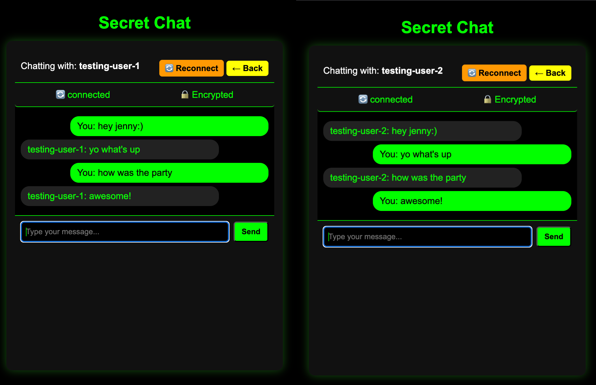

# secret-chat

A browser-based chat where the two people talk directly to each other. The Flask
server is only a switchboard: it keeps track of who is online and passes the
connection handshake between them. Message contents never go through it.



## How it works

```
Browser A                 Flask server                 Browser B
    |                          |                          |
    |-- register / heartbeat ->|<- register / heartbeat --|
    |                          |                          |
    |-- SDP offer ------------>|--- SDP offer ----------->|
    |<-- SDP answer -----------|<-- SDP answer -----------|
    |<-- ICE candidates ------>|<-- ICE candidates ------>|
    |                          |                          |
    |==== RTCDataChannel: DTLS-encrypted, end to end ====|
```

1. Both users open the page and enter a display name.
2. A heartbeat keeps the online list fresh; users idle for more than 30 seconds drop off.
3. Selecting a peer opens an `RTCPeerConnection`.
4. The server stores SDP offers/answers and ICE candidates in memory and hands
   them to the other side. It clears them once fetched.
5. Once ICE finishes, a data channel carries the messages.

## What is and is not encrypted

Being precise matters here, so:

* **Message content is encrypted in transit by DTLS** — that is part of WebRTC and
  is negotiated by the browser, not by this code.
* **The server never receives message text**, only signalling data (SDP and ICE).
  In that sense the chat is peer-to-peer.
* **There is no identity verification.** Usernames are self-asserted, and no keys
  are pinned or compared out of band. A malicious signalling server could relay
  its own SDP and sit in the middle. This is a prototype, not a
  threat-model-complete secure messenger.
* **Messages are not stored.** They live in the page and disappear on reload.

## Running it locally

Requires Python 3.9+ and Flask.

```bash
git clone https://github.com/SHLEAK/secret-chat.git
cd secret-chat
python3 -m venv .venv && source .venv/bin/activate
pip install flask
python3 server.py
```

Then open <http://localhost:5000> in two separate windows (or two browsers), enter
different names, and select each other from the online list.

Both sides must select each other to establish the channel.

## Project layout

```
server.py            Flask app: user registry, heartbeat, signalling relay
templates/index.html Markup for login, user list and chat panes
static/chat.js       WebRTC negotiation, data channel, UI state
static/style.css     Styling
```

## Known limitations

* **No authentication** — anyone can claim any name.
* **No key verification** — see the security note above.
* **Signalling is polled** once per second rather than pushed.
* **Both peers attempt to offer**, which can cause glare; a perfect-negotiation
  pattern would make this robust.
* **State is in memory** — a restart clears the online list and pending signals.
* **STUN only, no TURN** — connections across restrictive NATs may fail.

## Next steps

* Perfect negotiation with the polite/impolite peer pattern
* A short authentication string (SAS) so both sides can compare a fingerprint
* TURN fallback for difficult networks
* Optional message history in SQLite

## Screenshots

`preview.png` at the top of this file shows two browser windows connected through
the app. A short GIF of the handshake and a first message would be a worthwhile
addition.

## License

Apache 2.0 — see [LICENSE](LICENSE).
